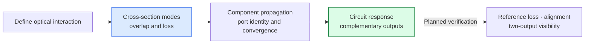
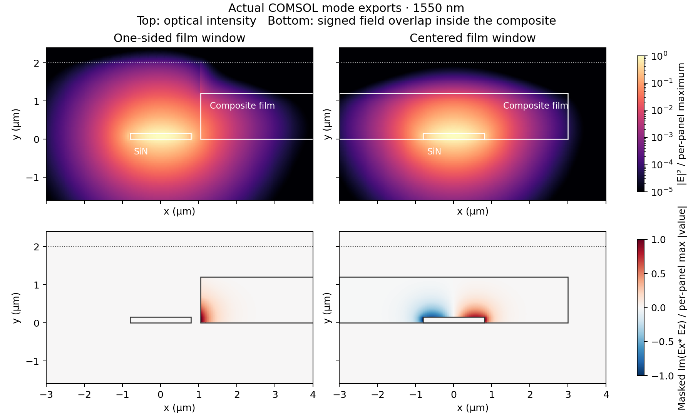
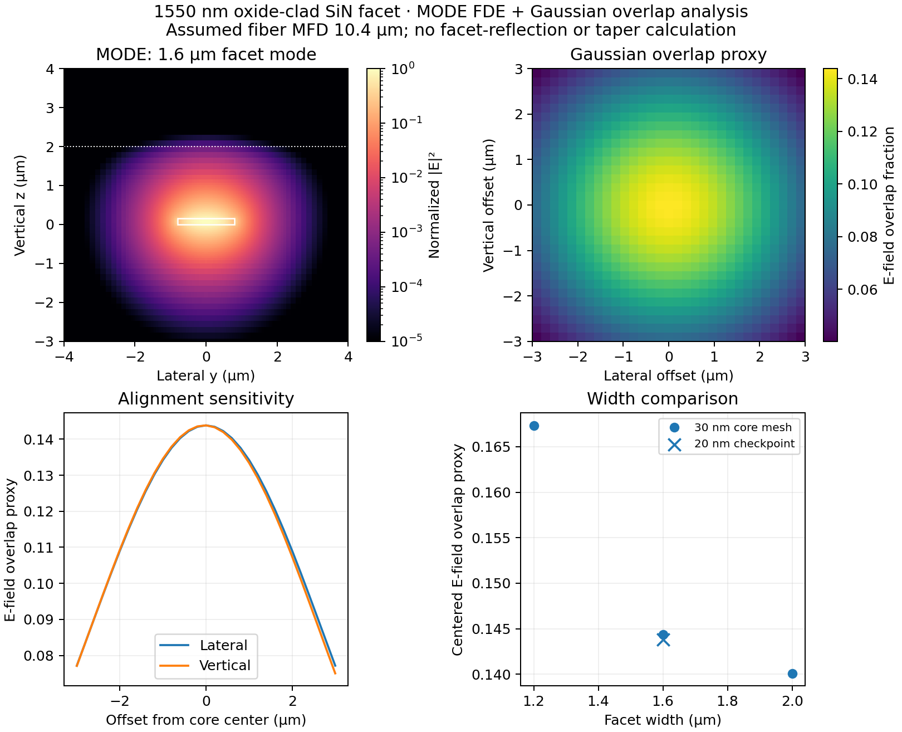
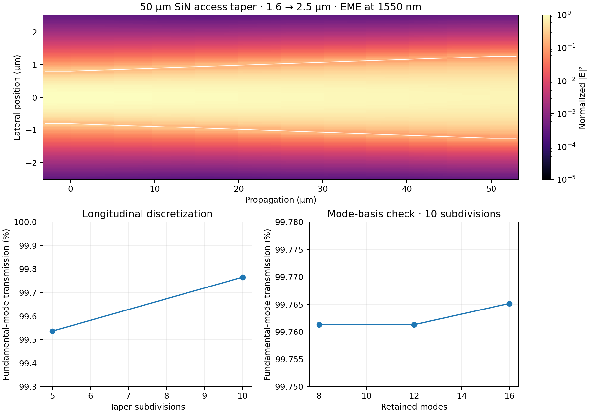
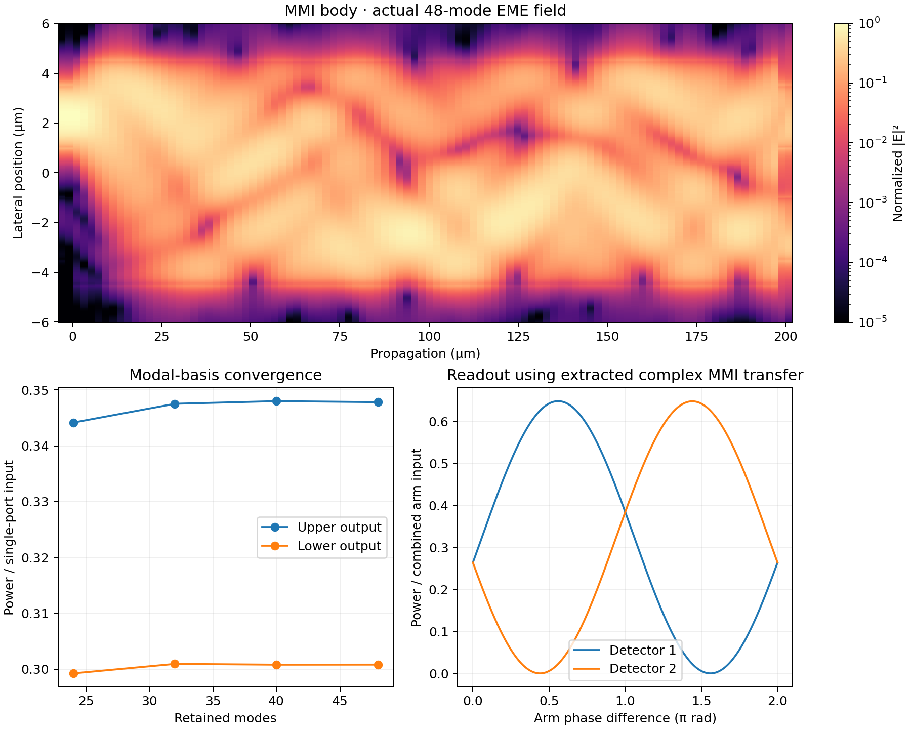
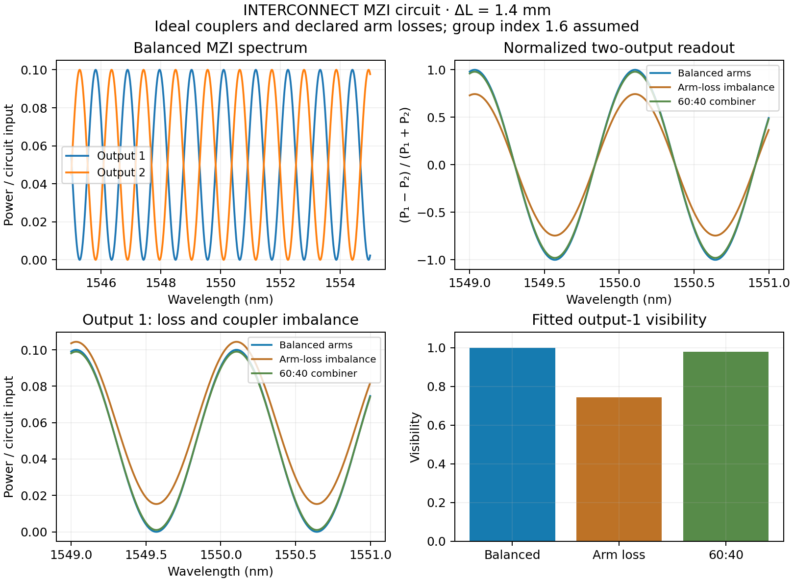

# Silicon Nitride Interferometers

**Optical-mode analysis, component propagation and dual-output circuits**

This design study examines how a material-interaction window and imperfect optical components affect a 1550 nm Mach–Zehnder interferometer. The engineering goal is to connect modal overlap, loss and component balance with measurements that can distinguish the underlying causes.

**Stage:** simulation and layout study. Chip readout and complete fiber-array coupling remain to be validated.

## 1. Inspect the optical interaction

Actual COMSOL cross-section exports show how window placement changes field overlap. Panels are normalized separately. Signed material-overlap cancellation is model dependent; these are mode fields, not time-domain propagation images or measured sensitivity.

## 2. Separate facet overlap from coupling efficiency

The oxide-clad facet field is compared with an assumed Gaussian fiber field. The map is a single-channel electric-field overlap proxy. It excludes facet scattering and reflection and does not validate a complete fiber-array interface.

## 3. Verify component transport

The EME study examines the routing-to-MMI access taper with selected port modes and subdivision/modal-basis checks. A component transmission result does not establish complete device throughput; mesh and domain checks remain relevant.

The oxide-reference model uses a straight-guide control to check port mapping. Mode-basis comparisons support interpretation of the collected output modes. The transfer-data response is a component-based prediction; substrate, access structures and full-device validation are separate requirements.

## 4. Evaluate the circuit readout

Existing INTERCONNECT runs compare balanced arms, arm-loss imbalance and an unequal combiner. Complementary outputs reveal how component assumptions affect fringe contrast and normalized readout. The circuit uses ideal couplers and an assumed group index.
## What the study changes

The models identify separate checks for mode selection, component loss, arm imbalance and facet alignment. The proposed readout uses a fiber-array interface and two detectors, with reference structures to separate coupling loss from sensing-path loss. This architecture remains planned chip characterization.

[Evidence and disclosure scope](CONTENT_NOTES.md) · [Optical-bench portfolio](https://github.com/juh112/photonics-testbenches-public)
