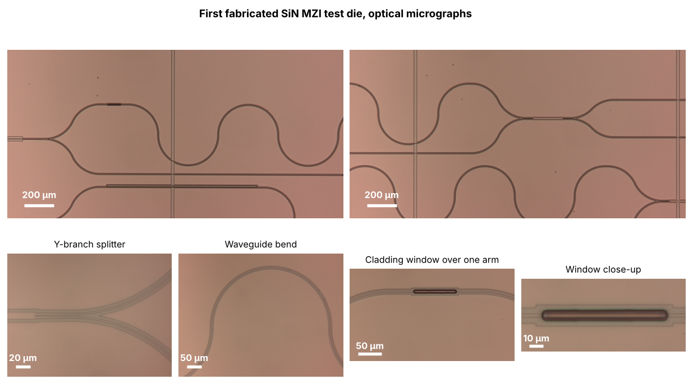
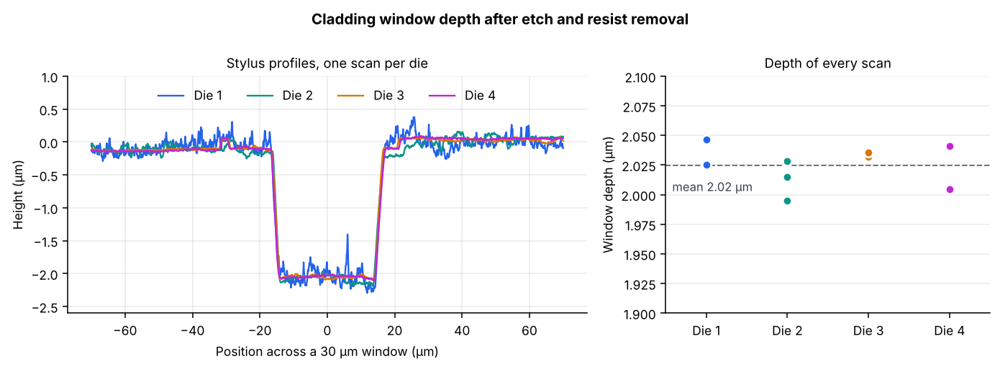
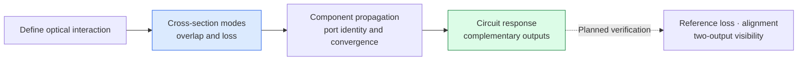
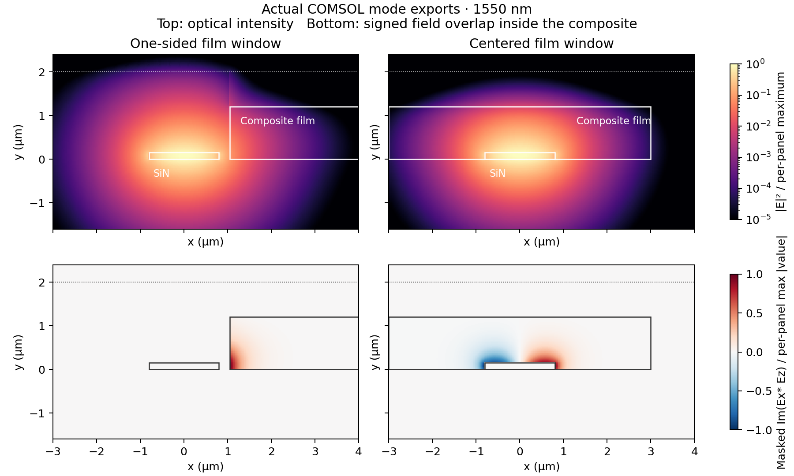
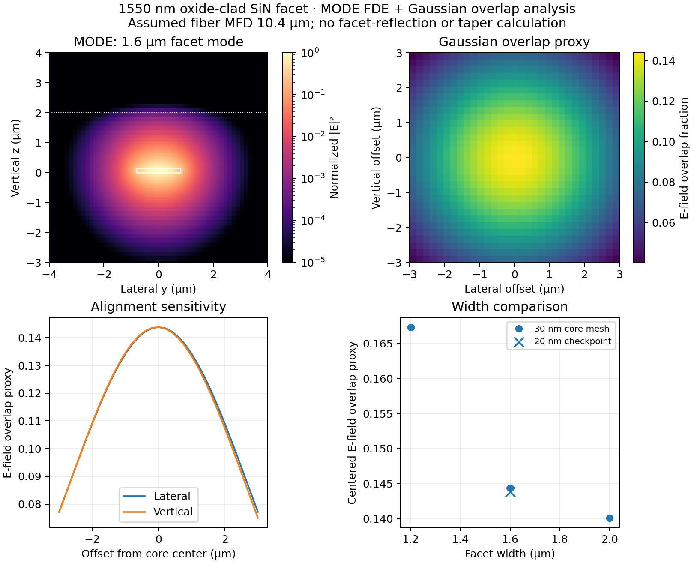
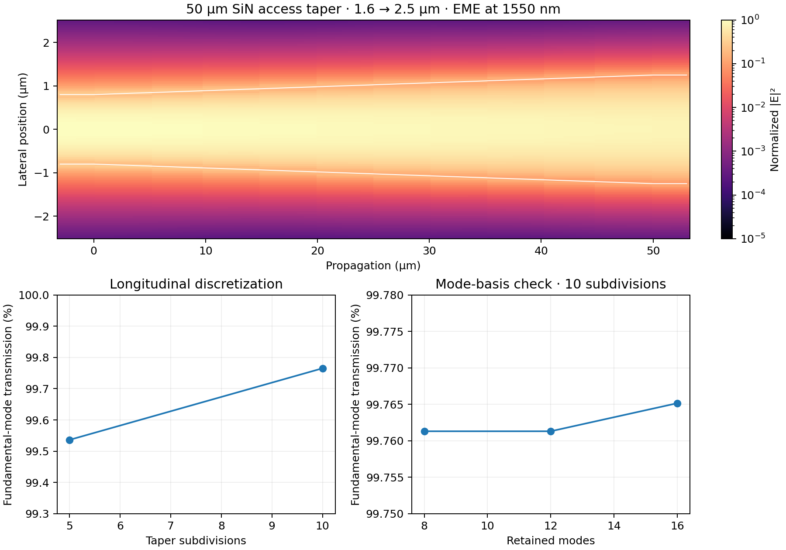
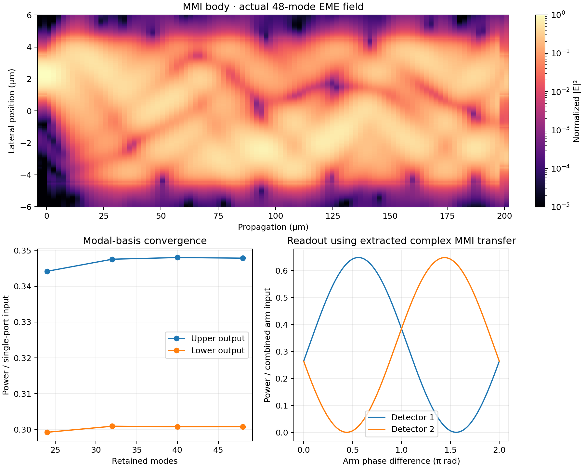
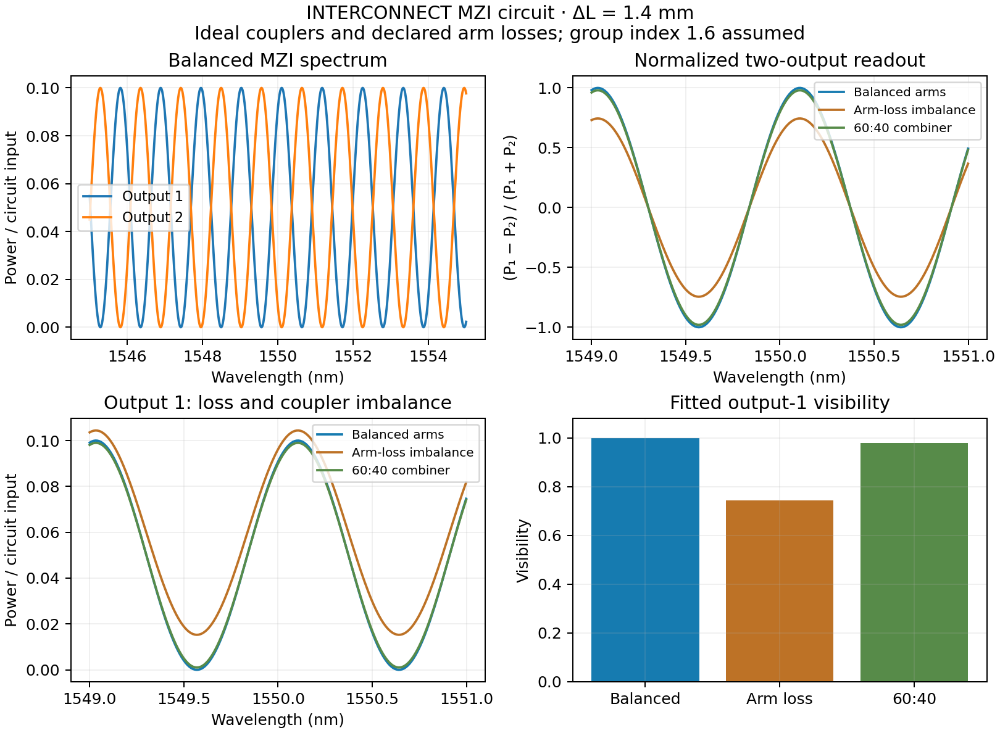

# Silicon Nitride Interferometers

**Optical-mode analysis, component propagation and dual-output circuits**

This design and fabrication study examines how a material-interaction window and imperfect optical components affect a 1550 nm Mach–Zehnder interferometer. The engineering goal is to connect modal overlap, loss and component balance with measurements that can distinguish the underlying causes.

*Fabricated test die. MZIs with cladding windows for field-odd and field-even responses, after window etch and resist removal. Optical transmission measurements are next.*

*Window depth measured by stylus profilometry on four dies. All nine scans fall within 2.00 to 2.05 µm (mean 2.02 µm), showing a uniform etch depth across the wafer.*

**Stage:** test chips fabricated. Chip readout and complete fiber-array coupling remain to be validated.

## 1. Inspect the optical interaction

Actual COMSOL cross-section exports show how window placement changes field overlap. Panels are normalized separately. Signed material-overlap cancellation is model dependent; these are mode fields, not time-domain propagation images or measured sensitivity.

## 2. Separate facet overlap from coupling efficiency

The oxide-clad facet field is compared with an assumed Gaussian fiber field. The map is a single-channel electric-field overlap proxy. It excludes facet scattering and reflection and does not validate a complete fiber-array interface.

## 3. Verify component transport

The EME study examines the routing-to-MMI access taper with selected port modes and subdivision/modal-basis checks. A component transmission result does not establish complete device throughput; mesh and domain checks remain relevant.

The oxide-reference model uses a straight-guide control to check port mapping. Mode-basis comparisons support interpretation of the collected output modes. The transfer-data response is a component-based prediction; substrate, access structures and full-device validation are separate requirements.

## 4. Evaluate the circuit readout

Existing INTERCONNECT runs compare balanced arms, arm-loss imbalance and an unequal combiner. Complementary outputs reveal how component assumptions affect fringe contrast and normalized readout. The circuit uses ideal couplers and an assumed group index.

## What the study changes

The models identify separate checks for mode selection, component loss, arm imbalance and facet alignment. The proposed readout uses a fiber-array interface and two detectors, with reference structures to separate coupling loss from sensing-path loss. This architecture remains planned chip characterization.

[Evidence and disclosure scope](CONTENT_NOTES.md) · [Optical-bench portfolio](https://github.com/juh112/photonics-testbenches-public)

## Research status and future updates

This repository is an evolving record of interferometer design, fabrication, and characterization. New devices or measurement campaigns can be documented as additional studies without replacing earlier models or observations.

| Workstream | Current evidence | Future additions |
|---|---|---|
| **Modes & material interaction** | COMSOL mode-field and overlap studies | New stacks, interaction geometries, and sensitivity checks |
| **Components & circuits** | MODE/EME taper and MMI studies; INTERCONNECT circuit predictions | Component variants, convergence studies, and updated circuit models |
| **Fabrication & metrology** | Fabricated test dies and measured window-depth profiles | Additional die measurements, process comparisons, and cross-sections |
| **Optical characterization** | Proposed fiber-array and dual-detector verification architecture | Alignment tests, reference-path measurements, and measured two-output spectra |

**Evidence convention:** simulated predictions, fabricated structures, instrument observations, and validated optical performance are distinct evidence levels. At present, complete optical transmission and chip readout are not validated. Future entries should identify dates, device variants, measurement controls, and supporting files when public disclosure is permitted.
